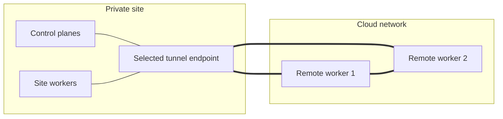
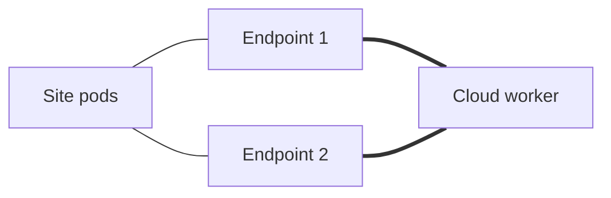
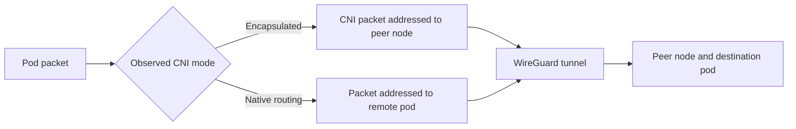
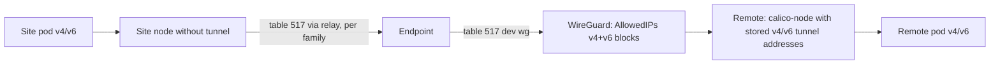
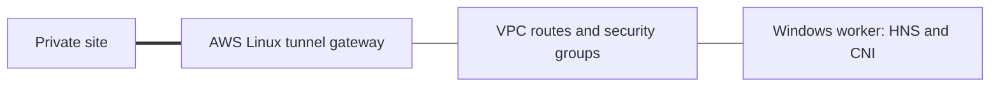
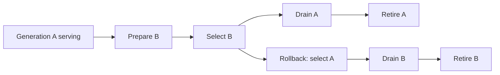

# Tunnel scenarios and validation

Kubernetes guests use one physical Ethernet NIC. WireGuard devices are virtual
interfaces. Local VM management uses QEMU Guest Agent over virtio-serial; AWS
management uses SSM where the instance profile and image provide it. CAPI itself
does not supply a universal out-of-band management channel.

## One site endpoint and cloud workers

The site endpoint initiates WireGuard traffic toward each cloud worker's public
listener. Site nodes reach remote pods through that endpoint. Cloud workers also
peer with one another, allowing remote-to-remote traffic across cloud networks.

Recorded tests:

Multi-provider AWS,
  Azure, and Google Cloud qualification requires separate assets and campaigns.

## Multiple site endpoints and outages

Selecting two endpoints gives the site more than one tunnel path. Route selection
and withdrawal follow the deployed CNI and the product's site-routing integration.

## CNI encapsulation and native routing

For encapsulated profiles, a pod packet enters its CNI tunnel first; WireGuard
carries the resulting node-to-node packet across the site/cloud boundary.
Native routing profiles carry pod addresses directly and authorize the owning
node's pod prefixes in WireGuard.

## Dual-stack native Calico BGP

The `calico-bird-dualstack` VM profile reproduces a deployed k0s v1.36.4+k0s.1
site with bundled Calico v3.32.1-3 in BGP mode without encapsulation, IPv4 and
IPv6 pools, one controller that is also a worker and two workers, each known by
identity addresses on a dummy device. Calico runs on the remotes as well. Remote
pod blocks of both families reach the site through the endpoints' table 517 and
the site-transit routes of nodes without a tunnel; BGP stays refused across the
tunnel in both families. See [dual-stack meshes](dual-stack.md) for what the
product does and the cluster settings it requires.

## Windows through an AWS gateway attachment

A gateway attachment can route traffic between Windows worker interfaces and the
site through an AWS Linux gateway. Its lifecycle owns route-table entries,
security-group ingress, forwarding configuration, and CNI transport publication.

## Generation switch, rollback, and retirement

Generation handover prepares a second set of WireGuard keys and devices, switches
the selected path, drains the former generation, and retires it. Rollback restores
the former path before draining the abandoned generation.

These are host-level experiments. Production CNI/HNS policy and controller-driven
handover require separate integration. See [handover design](tunnel-handover.md) for persisted receipt
rounds, drain policy, and remaining acceptance gates.
